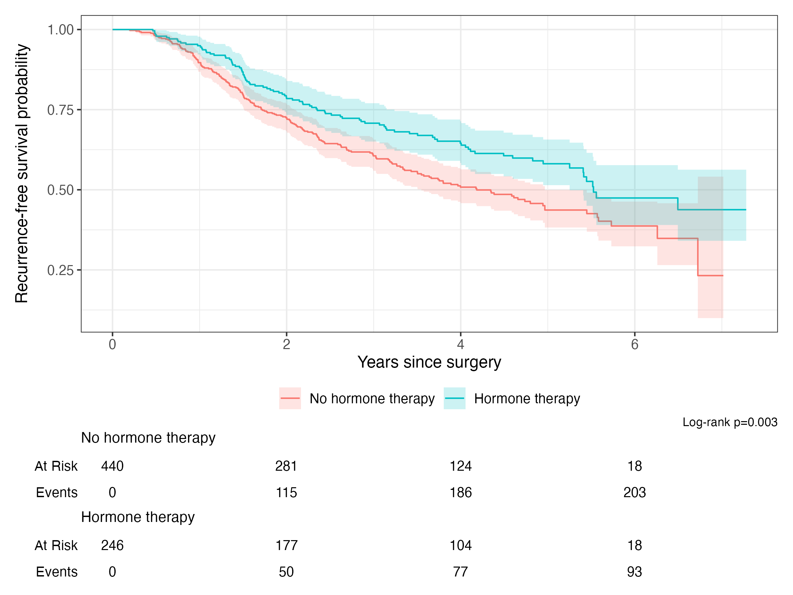
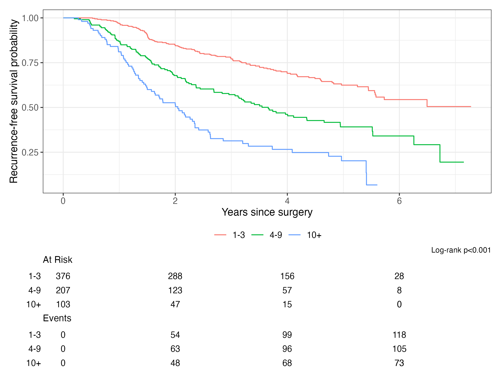
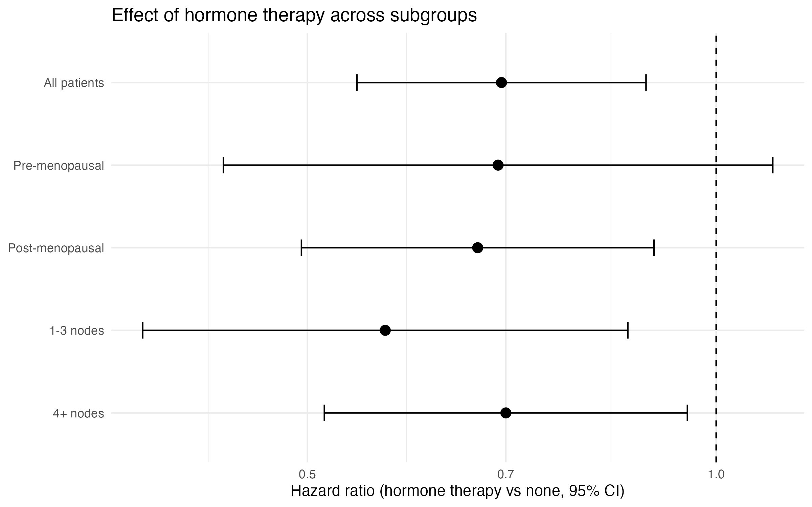
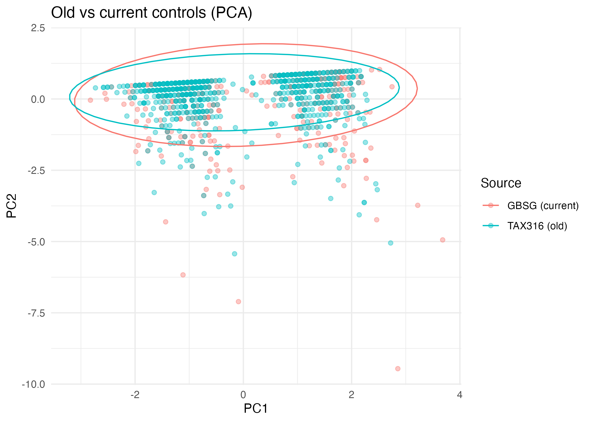
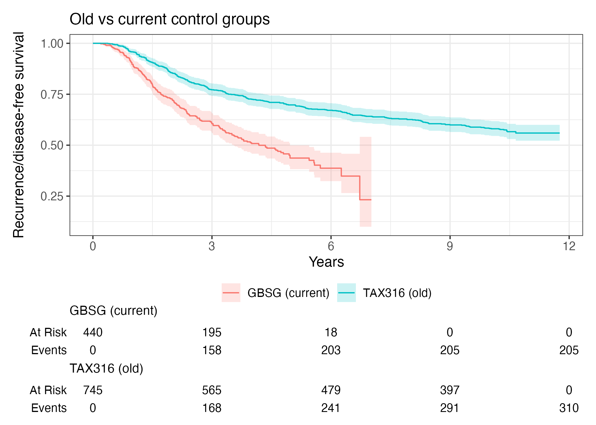
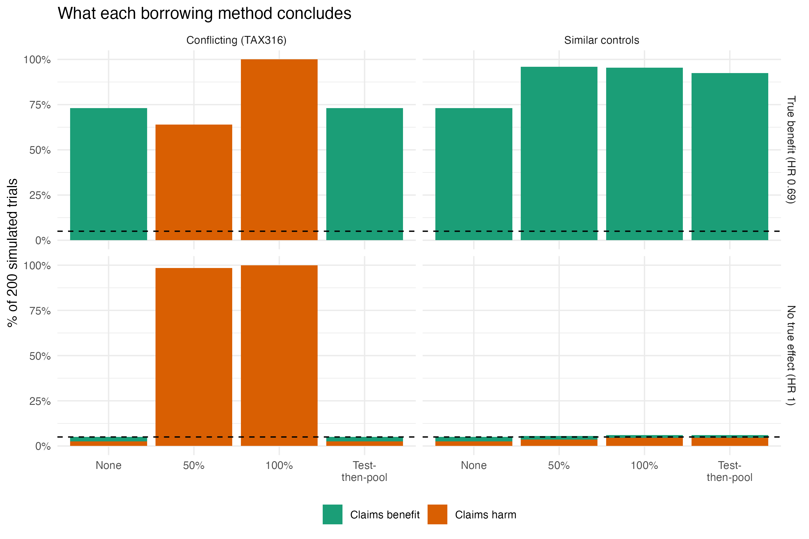

# Efficacy & Historical-Control Borrowing in Node-Positive Breast Cancer Trials (R)

This project asks two questions about women with breast cancer that has spread to the lymph nodes:

1. **Does hormone therapy (tamoxifen) delay the cancer coming back?**
2. **Can a trial use fewer control patients by borrowing control patients from an older trial, and when is that safe?**

**Main findings**

- Hormone therapy lowered the risk of recurrence by about **29%** (adjusted HR 0.71, 95% CI 0.55–0.91).
- Old-trial control patients looked similar on age, menopause and nodes, but **did much better** (5-year disease-free 70% vs 44%).
- Borrowing those patients **reversed the answer**: the therapy looked harmful.
- In a simulation, borrowing **raised power from 73% to about 95%** when the old patients really were similar. A simple "test-then-pool" rule kept most of that gain and **avoided the wrong answer** when they were not.

---

## Data

| Data | What it is | Patients |
|---|---|---|
| `gbsg` (R `survival` package) | German Breast Cancer Study Group: node-positive women, hormone therapy vs none | 686 (246 treated, 440 untreated) |
| NCT00688740 (Sanofi TAX316), via [Project Data Sphere](https://www.projectdatasphere.org) | Control arm (FAC chemotherapy) of a Phase III trial in node-positive early breast cancer, in CDISC-style SAS files | 746 |

**Outcome:** time until the cancer came back or the patient died (recurrence-free survival in GBSG; disease-free survival in TAX316).

> The TAX316 data cannot be shared, so the `data/` folder is not in this repository. To re-run Part 2, request NCT00688740 from Project Data Sphere and put `adsl`, `addm` and `adds` in `data/`.

---

## Part 1: Does hormone therapy work?

Hormone therapy was **not fully randomised** in GBSG, so the treated women were different at the start (older, more often post-menopausal, higher ER). The analysis adjusts for these differences.

### Patient characteristics (Table 1)

Treated women were older (median 58 vs 50 years), more often post-menopausal (76% vs 48%) and had higher ER levels (p = 0.009). Tumour size, grade, nodes and PgR were similar.

### Survival curves



| | Hormone therapy | No hormone therapy |
|---|---|---|
| Recurrence-free at 5 years | **58.1%** (51.4–65.7) | **43.7%** (38.2–49.9) |
| Median time to recurrence | 5.5 years | 4.2 years |

Log-rank test: χ² = 8.6, p = 0.003. Median follow-up: 4.5 years.

More positive lymph nodes meant much worse outcomes (median recurrence-free time: not reached for 1–3 nodes, 3.7 years for 4–9, 2.1 years for 10+; p < 0.001).



### Cox regression (size of the benefit)

| Model | Hazard ratio for hormone therapy | 95% CI | p |
|---|---|---|---|
| Unadjusted | 0.69 | 0.54–0.89 | |
| Adjusted for age, menopause, size, grade, nodes, PgR, ER | **0.71** | 0.55–0.91 | 0.007 |
| Stratified by grade and menopause | 0.70 | 0.54–0.90 | |

- **What HR 0.71 means:** at any point in time, treated women had about 29% lower risk of recurrence.
- Other strong risk factors: grade 3 (HR 2.18), each extra node (HR 1.05), higher PgR was protective (HR 0.80 per 100 units).
- Model accuracy: C-index 0.69 (it ranks patients' risk correctly about 69% of the time).

### Checks

- **Proportional hazards (`cox.zph`):** fine for treatment (p = 0.63), but not for some other variables (global p = 0.004). A model stratified by grade and menopause fixed this (global p = 0.25) and gave the same treatment effect.
- **Multicollinearity:** all VIF < 3. ER and PgR are related (Spearman r = 0.60) but not too strongly.
- **Logistic regression (recurrence within 5 years):** OR 0.34 (0.20–0.56). This overstates the effect because women followed for less than 5 years had to be left out (280 of 686), so the Cox model is the main analysis.

### Does the benefit hold in subgroups?



The benefit was similar before and after menopause (interaction p = 0.89) and for 1–3 vs 4+ nodes (interaction p = 0.49).

---

## Part 2: Borrowing control patients from an older trial

### Why borrow?

Trials often struggle to recruit control patients. If similar control patients exist from an older trial, could we use them instead? The risk: if the old patients are different, the answer will be **biased**.

### Step 1: Turning raw trial files into survival data

The TAX316 files are in CDISC-style SAS format (read with `haven`). The disposition file (`adds`) had **13,000+ rows**, with many rows per patient.

- **Event** = first breast cancer relapse or second primary cancer.
- **Censored** = no event, followed up to the last contact.
- One patient with no follow-up was removed, leaving **745 patients and 310 events**.

**Check against the published trial:**

| | This build | Published FAC arm |
|---|---|---|
| Disease-free at 5 years | 69.8% | about 68% |
| Disease-free at 10 years | 58.2% | about 55% |

My numbers are slightly higher because deaths without a relapse were not in the file I had.

### Step 2: Are the old controls like the current ones?

Only **age, menopause and number of nodes** were recorded in both studies.

| | GBSG controls (n = 440) | TAX316 controls (n = 745) | p |
|---|---|---|---|
| Age, median | 50 | 49 | 0.003 |
| Post-menopausal | 48% | 45% | 0.4 |
| Nodes, median | 3 | 3 | 0.09 |

- **Hotelling's T²** (all three variables together): F = 7.57 on (3, 1182) df, p < 0.001. The averages differ slightly, mostly in age.
- **Mahalanobis distance:** 2.7% of old patients were unusual, compared with 2.5% of current patients. So individual patients overlap well.
- **PCA:** the first two components explain 92% of the variation, and the two groups overlap almost completely.



**But their outcomes were very different:**



Log-rank χ² = 71.5, p < 0.001. The old controls stayed disease-free much longer, probably because of a different era, different chemotherapy and better care.

> **Key lesson:** patients that look similar at the start do not always have similar outcomes.

### Step 3: A "pretend" small trial

I kept all 246 treated women but only a random third of the controls (146), as if recruitment had fallen short. All models adjust for age, menopause and nodes.

| Analysis | HR | 95% CI | p | Conclusion |
|---|---|---|---|---|
| Full trial (the "true" answer) | 0.69 | 0.54–0.89 | 0.004 | Works |
| Small trial, no borrowing | 0.77 | 0.55–1.07 | 0.12 | Not sure |
| + old controls at 25% weight | 1.20 | 0.93–1.54 | 0.16 | Not sure (wrong direction) |
| + old controls at 50% weight | 1.34 | 1.06–1.70 | 0.015 | **Looks harmful (wrong)** |
| + old controls at 100% weight | 1.47 | 1.17–1.86 | 0.001 | **Looks harmful (wrong)** |
| Test-then-pool | 0.77 | | | Refused to borrow (log-rank p < 0.001) |

**How the weighting works:** a weight of 0.5 means each old patient counts as half a current patient. This is the same idea as a Bayesian *power prior* with a fixed amount of borrowing, done here with a weighted Cox model.

**Test-then-pool:** first test whether the old and current controls have similar outcomes. Borrow fully only if they do; otherwise do not borrow.

### Step 4: Simulation (200 repeats)

I repeated the small trial 200 times with different random samples, in four situations:

- **True benefit** (real treated women) or **no true effect** (control patients pretending to be treated)
- Old controls that **conflict** (TAX316) or are **similar** (unused GBSG controls)



| | No borrowing | 50% | 100% | Test-then-pool |
|---|---|---|---|---|
| Finds the real benefit, similar old controls | 73% | 96% | 96% | **93%** |
| Finds the real benefit, TAX316 old controls | 73% | 0% | 0% | **73%** |
| Wrongly says "harmful", TAX316, true benefit | 0% | 64% | 100% | **0%** |
| Any false result when there is no effect, similar old controls | 5% | 6% | 6% | **6%** |

**In short:** borrowing helps a lot when the old data really match, and goes badly wrong when they do not. Test-then-pool gets most of the benefit while protecting against the risk.

---

## Limitations

- **Missing variables:** TAX316 had no tumour size, grade, ER or PgR, so the groups could not be compared on these.
- **Deaths:** deaths without a relapse were not in the TAX316 file I had (the efficacy file would not download), so its disease-free survival is slightly too high.
- **Different outcome definitions:** recurrence-free survival (GBSG) vs disease-free survival (TAX316) are close but not identical.
- **Menopause codes:** TAX316 menopause codes 3 and 4 had no labels. They split exactly at age 50, so I treated them as pre (under 50) and post (50+).
- **Simulation:** the "similar" old controls came from the same study, which is the best possible case. Only controls were resampled, so power may be a little optimistic.
- **Not fully Bayesian:** fixed-weight borrowing matches a power prior with a fixed weight, but no posterior distribution was calculated.

## What I would do next

- Fully Bayesian dynamic borrowing (for example `psborrow2`), where the data decide how much to borrow
- Match or weight old patients to current ones (propensity scores) before borrowing
- Get the TAX316 efficacy file to include deaths

---

## How to run

```r
install.packages(c("survival", "tidyverse", "gtsummary", "ggsurvfit",
                   "broom", "car", "DescTools", "haven"))
```

Run the scripts in order:

| Script | What it does |
|---|---|
| `01_explore_data.R` | Data preparation, Table 1, Kaplan–Meier, log-rank, ANOVA |
| `R/02_cox_model.R` | Cox models, assumption checks, logistic regression, VIF, subgroups |
| `R/03_read_old_controls.R` | Reads TAX316 SAS files; compares old vs current controls (tests, Hotelling, Mahalanobis, PCA) |
| `R/04_build_dfs.R` | Builds one-row-per-patient disease-free survival from `adds`; checks against the published trial |
| `R/05_borrowing.R` | Small trial, weighted borrowing, test-then-pool, simulation |

Results are saved in `output/`; notes are in `docs/result_notes.md`.

**Tools:** R · survival · tidyverse · gtsummary · ggsurvfit · haven · DescTools · car · Git/GitHub
